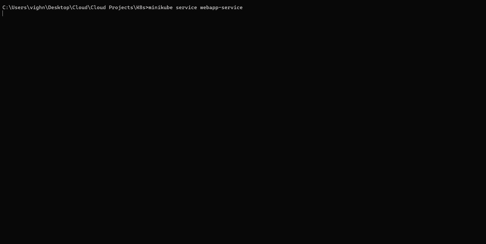
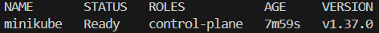
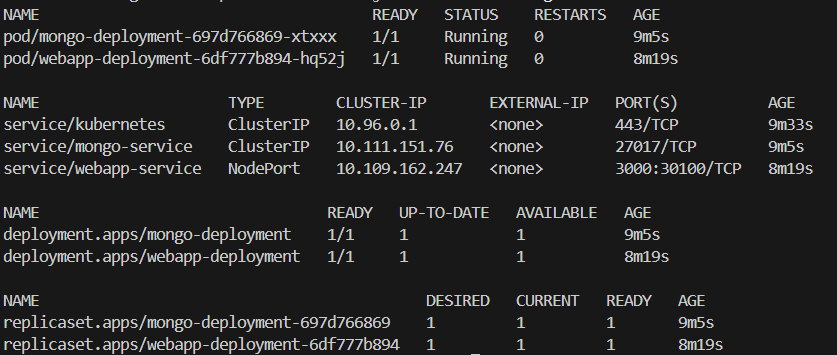

# Web App + MongoDB on Kubernetes (Minikube)

A two-tier application deployed to a local Kubernetes cluster with Minikube: a **web app** (port 3000) backed by a **MongoDB** database, connected with a ConfigMap, a Secret and Services.

## What this project demonstrates

- Writing Kubernetes manifests (Deployments, Services, ConfigMap, Secret)
- Keeping credentials in a Secret and non-sensitive config in a ConfigMap
- Internal service discovery: the web app reaches MongoDB through `mongo-service`
- Exposing an app outside the cluster with a NodePort Service
- Verifying and debugging with `kubectl`

## Architecture

```
Browser
   |
   v
[ webapp-service ]       NodePort, port 3000 -> nodePort 30100
   |
   v
[ webapp pod ]           Deployment: webapp-deployment
   |   DB address from ConfigMap, credentials from Secret
   v
[ mongo-service ]        ClusterIP (internal only), port 27017
   |
   v
[ mongo pod ]            Deployment: mongo-deployment
```

**Request flow**

1. The user opens `<minikube-ip>:30100` (or the URL from `minikube service`) in a browser.
2. `webapp-service` forwards the request to the web app pod on port 3000.
3. The app connects to MongoDB using the address from the ConfigMap and the credentials from the Secret.
4. `mongo-service` routes the connection to the MongoDB pod on port 27017.

## Demo

### Web app in action


### Local cluster


### Cluster resources (`kubectl get all`)


Both pods are `Running` with 0 restarts. Each Deployment created its own ReplicaSet, `mongo-service` is internal-only (ClusterIP), and `webapp-service` is exposed on NodePort 30100.

## Components

| File | Kind | Purpose |
|------|------|---------|
| `mongo-secret.yaml` | Secret | MongoDB username and password (base64-encoded) |
| `mongo-config.yaml` | ConfigMap | Database URL (`mongo-service`) for the web app |
| `mongo.yaml` | Deployment + Service | MongoDB pod and internal Service (27017) |
| `webapp.yaml` | Deployment + Service | Web app pod and NodePort Service (3000 -> 30100) |

## Prerequisites

- [Docker](https://docs.docker.com/get-docker/)
- [kubectl](https://kubernetes.io/docs/tasks/tools/)
- [Minikube](https://minikube.sigs.k8s.io/docs/start/)

## Getting started

```bash
# 1. Start the cluster
minikube start --driver=docker
kubectl get nodes

# 2. Create the Secret and ConfigMap first (the Deployments reference them)
kubectl apply -f mongo-secret.yaml
kubectl apply -f mongo-config.yaml

# 3. Deploy MongoDB, then the web app
kubectl apply -f mongo.yaml
kubectl apply -f webapp.yaml

# 4. Verify
kubectl get all

# 5. Open the app
minikube service webapp-service
```

If you use the Docker driver on macOS or Windows, `minikube service webapp-service` is the reliable way to reach the NodePort, since the node IP isn't directly reachable from the host.

## Design notes

- **Secret for credentials:** injected as environment variables via `secretKeyRef` instead of being hardcoded. Secrets are only base64-encoded by default, not encrypted, so don't commit real credentials.
- **ConfigMap for config:** the database address lives outside the Deployment, so it can change without editing the app definition.
- **Service-based discovery:** pods are ephemeral and get new IPs when replaced, so the app connects to the stable `mongo-service` name.
- **ClusterIP vs NodePort:** the database is internal-only; only the web app is exposed.
- **Single replica, no persistence:** MongoDB has no PersistentVolume, so data is lost if its pod is replaced. Fine for a demo, not for production.

## Troubleshooting

```bash
kubectl get pods
kubectl describe pod <pod-name>
kubectl logs <pod-name>
kubectl describe service mongo-service    # Endpoints should match the pod IP
kubectl get pod -o wide
```

| Symptom | Likely cause |
|---------|--------------|
| `CreateContainerConfigError` | Secret or ConfigMap not applied yet, or a key name typo |
| `CrashLoopBackOff` on the web app | MongoDB not ready, or wrong credentials/URL |
| Service has no endpoints | Selector labels don't match the pod labels |
| Browser can't reach the URL | Use `minikube service webapp-service` |

## Cleanup

```bash
kubectl delete -f webapp.yaml -f mongo.yaml -f mongo-config.yaml -f mongo-secret.yaml
minikube stop        # or: minikube delete
```

## Future improvements

- Add a PersistentVolumeClaim so MongoDB data survives restarts
- Use a StatefulSet for MongoDB
- Add resource requests/limits and liveness/readiness probes
- Add an Ingress instead of a NodePort
- Package the manifests with Helm or Kustomize

## Credits

Concepts and project structure from Nana Janashia's "Kubernetes in 1 hour" tutorial.
https://gitlab.com/nanuchi/k8s-in-1-hour
